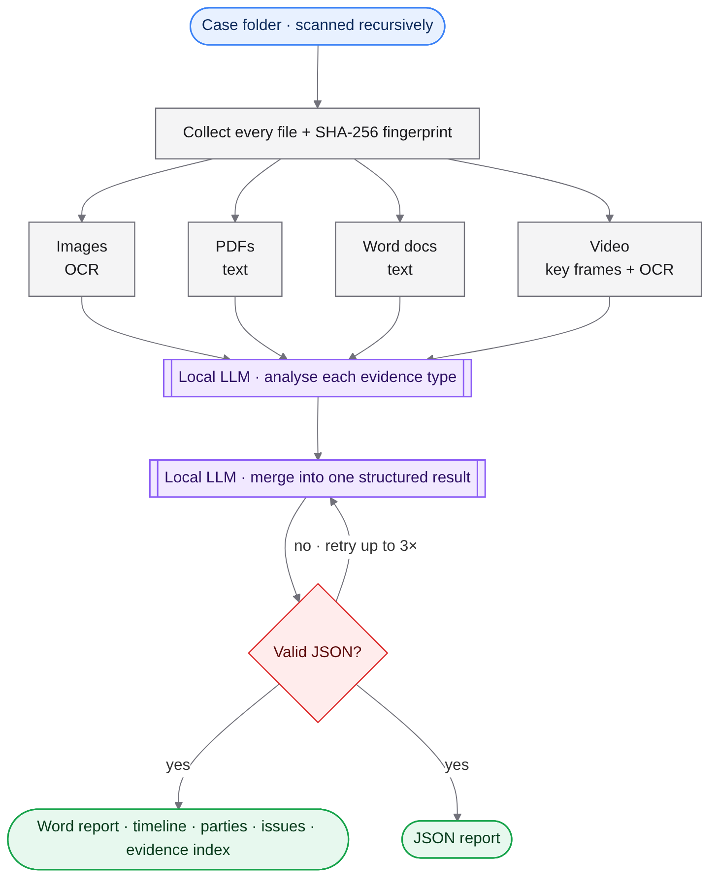
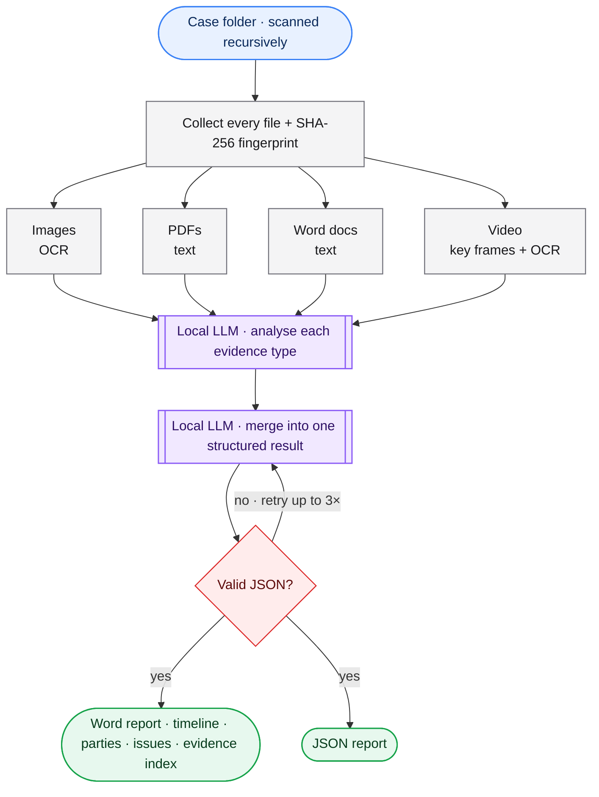

# Offline Case Analyzer

> 📘 New here? Start with **[READ_THIS_OVERVIEW.md](READ_THIS_OVERVIEW.md)** for a plain-English walkthrough.

Point it at a folder of mixed evidence — screenshots, PDFs, Word files, video — and get a structured case report, fully offline.

## Workflow



> **Diagram key:** blue = input · purple = AI model · grey = processing · amber = storage · red = safety / guard rail · green = output

<details><summary>Diagram source (renders on GitHub)</summary>


</details>

## What it does
- Walks a case folder and fingerprints every file so the report can reference exact evidence.
- Extracts text from images (OCR), PDFs, Word documents and frames pulled from video.
- Runs a local model over each evidence type, then a second pass that merges everything into one structured result.
- Validates the model's output before writing a formatted Word report and a JSON copy.
- Nothing leaves the machine — no cloud API.

## What this project demonstrates
- Multi-modal document pipeline (OCR, PDF, DOCX, video frames)
- Two-stage LLM map → reduce summarisation
- Strict JSON extraction from model output
- Automated report generation

## Quick start
1. Install Ollama and a model (default `llama3.2`), plus the Tesseract OCR program.
2. `pip install -r requirements.txt`
3. `python case_analyzer.py --case-folder ./MyCase --case-name "My case"`

## Project layout
```
case_analyzer.py   ← whole pipeline
run_case_analyzer.sh
```

## Notes
Produces an organised summary to help prepare for a lawyer — not legal advice.

## License
MIT — see [LICENSE](LICENSE).
